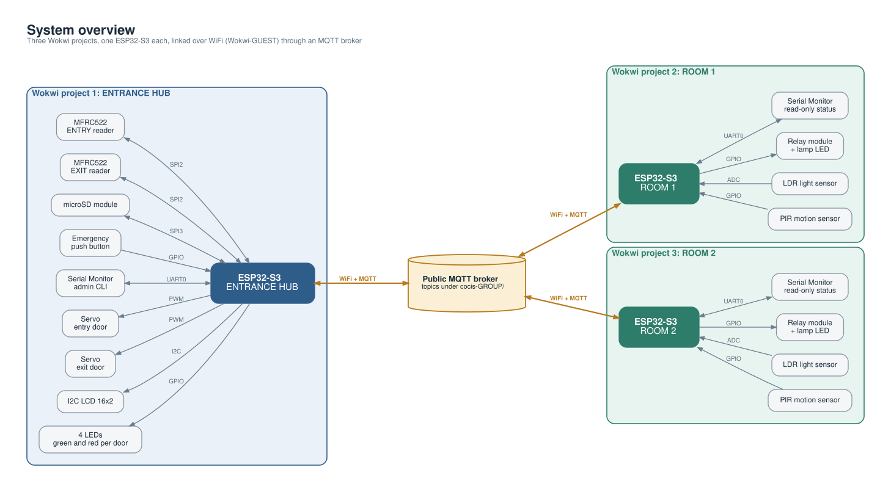
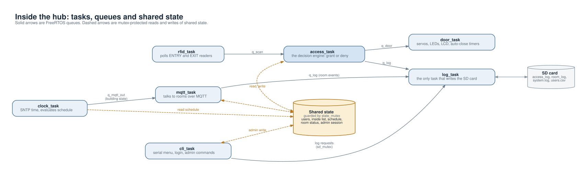
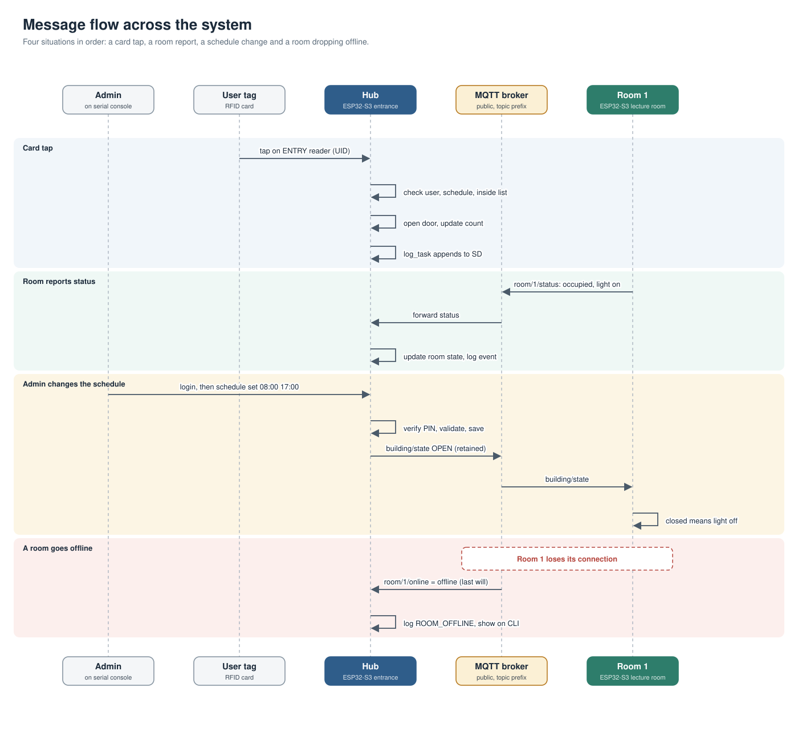
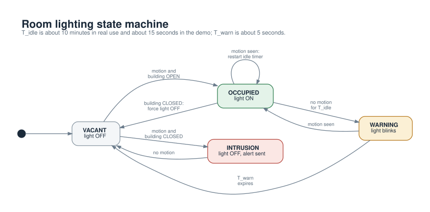
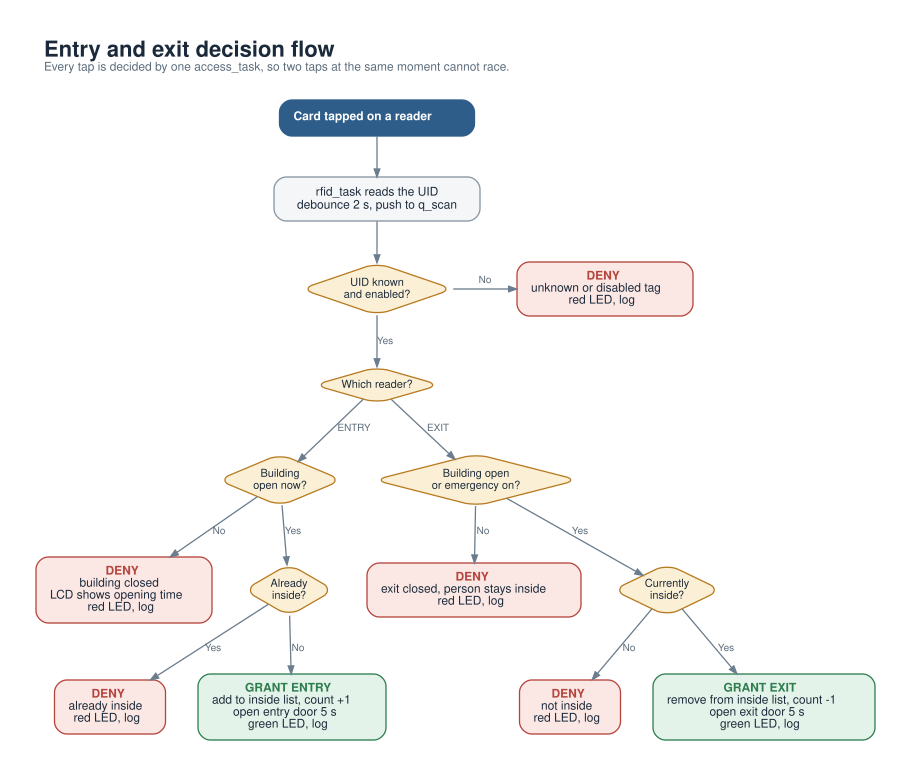

# CoCIS Smart Access & Environmental Control System — System Operation Report

## Group B members

| Name               | Registration number |
| ------------------ | ------------------- |
| Wamani Joshua      | 24/U/1415           |
| Namugerwa Precious | 24/U/1051           |
| Mutoni Esther      | 24/U/07511/PS       |
| Mungi Benjamin     | 24/U/07305/PS       |
| Namutebi Sulaina   | 24/U/09393/PS       |

---

## Table of contents

1. [System overview](#1-system-overview)
2. [High-level design & design decisions](#2-high-level-design--design-decisions)
3. [System architecture](#3-system-architecture)
4. [Hardware components & wiring](#4-hardware-components--wiring)
5. [Communication protocol: MQTT topics, QoS & last will](#5-communication-protocol-mqtt-topics-qos--last-will)
6. [Software design: hub firmware](#6-software-design-hub-firmware)
7. [Software design: room firmware](#7-software-design-room-firmware)
8. [Access control flow](#8-access-control-flow)
9. [Automated lighting flow](#9-automated-lighting-flow)
10. [Storage implementation: SD card & logging](#10-storage-implementation-sd-card--logging)
11. [Serial console: management menu & UART sharing](#11-serial-console-management-menu--uart-sharing)
12. [Data movement: how information flows through the system](#12-data-movement-how-information-flows-through-the-system)
13. [Synchronisation design: tasks, mutexes & semaphores](#13-synchronisation-design-tasks-mutexes--semaphores)
14. [Implemented features & requirements traceability](#14-implemented-features--requirements-traceability)
15. [Known limitations](#15-known-limitations)
16. [Wokwi simulation links](#16-wokwi-simulation-links)
17. [Individual contributions](#17-individual-contributions)

---

## 1. System overview

The CoCIS Smart Access & Environmental Control System addresses two problems in a university building: unauthorised access to rooms, and electricity wasted by lights left on in unoccupied rooms. The system covers one building entrance and two lecture rooms.

It is built as a **hub-and-spoke system** deployed across three Wokwi projects, each running one ESP32-S3 board:

- **Entrance hub** — owns all shared data: the user table, the inside list, the access schedule, emergency override state, all logs, and the room table. It runs two MFRC522 RFID readers (entry and exit), two door servos with LEDs, a 16×2 LCD, and an SD card.
- **Room terminals (×2)** — each owns only its local sensors (PIR motion, ultrasonic distance, LDR) and its light LED. They report occupied/light status to the hub over MQTT and follow the building state (open/closed/emergency) published by the hub.

Rooms never write to shared state and never touch the SD card. Only the hub changes shared data, so by topology there are no write conflicts between terminals.

The three terminals communicate over WiFi through a public MQTT broker (`broker.emqx.io` or a local Mosquitto instance, selectable by one config line). The hub publishes retained building state; rooms publish retained online status and periodic occupancy/light status; rooms also publish intrusion alerts.



---

## 2. High-level design & design decisions

#### 2.1 Core architectural principle: single logical writer

Every piece of shared state has exactly one logical writer, chosen by design:

| Shared state                                    | Logical writer                   |
| ----------------------------------------------- | -------------------------------- |
| Inside list (who is in the building)            | Entrance hub, decision task only |
| User table (users.csv cache)                    | Entrance hub, console / storage  |
| Access schedule & emergency override            | Entrance hub, management console |
| Room table (occupied / light / online per room) | Entrance hub, MQTT callback only |
| Access logs, room logs, system log              | Entrance hub, SD card            |
| Room-local presence and light state             | Each room terminal, locally only |

This single-writer rule is the primary mechanism for **consistency** and **reliability**. There is no distributed locking protocol, no consensus algorithm, and no two-phase commit. The answer to every conflict question is always "what does the hub's copy say?".

#### 2.2 Why not peer-to-peer

A peer-to-peer design where every board can write the schedule or the inside list would require distributed agreement. With three boards on a shared broker, that introduces write conflicts, last-writer-wins races, and partial-update corruption. The hub-and-spoke topology eliminates this class of bugs entirely: rooms are data sources (they publish sensor readings), the hub is the data sink and decision-maker (it consumes readings and publishes commands).

#### 2.3 Fail-safe defaults

The system defaults to safe states on failure:

- If WiFi or MQTT is down, the hub keeps making access decisions and driving doors locally; it resumes from retained messages on reconnect.
- If the SD card is absent or fails, logging is disabled but access control continues normally. An untrustworthy audit log is worse than a stopped one; locking people out because a log disk died is unacceptable.
- If SNTP has not set the clock, log rows are stamped `no-time` rather than a fabricated timestamp.
- If a room goes silent, its `online` flag drops via MQTT last will, and the hub marks it offline rather than showing stale data.

#### 2.4 One owner per resource (structural, not locked)

Where possible, concurrency is avoided by structure rather than by mutexes. The LCD, servos, door LEDs, RFID chips, and SD card are each driven by exactly one task. A race would require adding a second caller — the code structure makes that visible.

#### 2.5 Retained messages & last will for distributed state

The broker, not application code, handles two distributed concerns:

- **Late join / reconnect**: important messages (building state, room online flags) are retained, so a subscriber gets the last value immediately on subscribe.
- **Silent terminal death**: MQTT last will publishes `<room>/offline` the instant a TCP connection drops, even mid-crash.

---

## 3. System architecture

#### 3.1 Terminals

| Terminal     | Board    | Role                         | Owns                                                |
| ------------ | -------- | ---------------------------- | --------------------------------------------------- |
| Entrance hub | ESP32-S3 | Decision engine + data owner | user table, inside list, schedule, logs, room table |
| Room 1       | ESP32-S3 | Local sensing + lighting     | PIR, ultrasonic, LDR, light LED                     |
| Room 2       | ESP32-S3 | Local sensing + lighting     | PIR, ultrasonic, LDR, light LED                     |

Each terminal is a separate Wokwi simulation running concurrently. Both rooms run **identical firmware**; they are distinguished only by their simulated MAC address in `diagram.json`. There is no copy-pasted room code variant.

#### 3.2 Hub firmware layout (one file per responsibility)

| File                     | Responsibility                                                                                                                                   |
| ------------------------ | ------------------------------------------------------------------------------------------------------------------------------------------------ |
| `app_main.c`             | Boot sequence: init management → net → rooms → storage → access; main loop publishes retained building state                                     |
| `net.c` / `app_config.h` | WiFi station, SNTP clock, MQTT client behind a small interface (`net_start`, `net_publish`, `net_publish_retained`, `net_time_ok`)               |
| `rfid_reader.c`          | Polls both MFRC522 chips over SPI, reads card UIDs, debounces repeats, pushes `{door side, UID}` scan events into a FreeRTOS queue               |
| `access_ctrl.c`          | The decision engine: one task, one input queue, the only place a door may be opened. Runs the full grant/deny check sequence                     |
| `occupancy.c`            | The "currently inside" list, protected by a FreeRTOS mutex                                                                                       |
| `door_ctrl.c`            | One task owning all door hardware: servos, LEDs, LCD messages, auto-close timers, emergency hold-open                                            |
| `lcd_i2c.c`              | 16×2 I2C display driver (PCF8574)                                                                                                                |
| `rooms.c`                | The hub's view of the rooms: rows with occupied/light/online, filled from incoming MQTT messages                                                 |
| `building.c`             | Publishes the retained building state (`open/closed/emergency inside=N`)                                                                         |
| `storage.c`              | SD card: mounts card, loads `users.csv` into RAM at boot, rewrites it on add/delete, appends three log files, degrades gracefully if card absent |
| `management_bridge.c`    | Glue mapping the console module's schedule/override state onto the interfaces the decision engine uses                                           |
| `hub_status.c`           | Extra status block for the console (occupancy + rooms)                                                                                           |

#### 3.3 Integration seams

Member contributions meet through two narrow seams rather than one big shared file:

- `hub_interfaces.h` declares what the decision engine needs: `user_lookup()` and `log_access()` (storage, member B), `schedule_is_open()` and `override_active()` (management, member E).
- The management component registers only `management_init()` / `management_start_cli()` in `app_main`; everything else is behind its own header.

#### 3.4 Room firmware layout

| File               | Responsibility                                                                                             |
| ------------------ | ---------------------------------------------------------------------------------------------------------- |
| `rooms/app_main.c` | Starts light sensing, connects WiFi/MQTT, publishes status + alerts on a loop                              |
| `rooms/light.c`    | One task every 100 ms implementing the lighting state machine (PIR + ultrasonic + LDR + vacancy + warning) |
| `rooms/net.c`      | WiFi, SNTP, MQTT client (same pattern as hub, different subscriptions)                                     |

---

## 4. Hardware components & wiring

#### 4.1 Entrance hub

| Component               | Qty | Purpose                                       | Pins                                                                          |
| ----------------------- | --- | --------------------------------------------- | ----------------------------------------------------------------------------- |
| ESP32-S3 DevKitC-1      | 1   | Hub controller                                | —                                                                             |
| MFRC522 RFID reader     | 2   | Entry + exit readers                          | Shared SPI: SCK 12, MOSI 11, MISO 13; CS entry 10, CS exit 9; RST tied to 3V3 |
| SG90 servo              | 2   | Door actuators (one per door)                 | LEDC 50 Hz: entry 15, exit 16                                                 |
| 16×2 LCD (I2C, PCF8574) | 1   | Welcome/Denied, occupancy count, time         | I2C SDA 17, SCL 18, address 0x27                                              |
| LEDs (green + red)      | 4   | Per door: permitted / denied                  | Entry: 1 (green), 2 (red); Exit: 38 (green), 39 (red)                         |
| MicroSD card            | 1   | `users.csv`, access log, room log, system log | SPI3: SCK 4, DI 5, DO 6, CS 7                                                 |

Both RFID readers share one SPI bus with separate chip-selects. RST is tied to 3V3 with soft reset in the driver. Strapping pins 0/3/45/46, USB pins 19/20, and flash pins 26–37 are avoided.



#### 4.2 Room terminal (×2)

| Component                  | Purpose                                                                  | Pins            |
| -------------------------- | ------------------------------------------------------------------------ | --------------- |
| HC-SR501-style PIR sensor  | Detects movement of a warm body                                          | GPIO 4          |
| HC-SR04 ultrasonic sensor  | Detects stationary objects (covers PIR blind spot: people sitting still) | Trig 7, Echo 15 |
| Photoresistor (LDR) module | Daylight check — light stays off when room is already bright             | GPIO 6          |
| LED + resistor             | Stands for the switched light                                            | GPIO 5          |

PIR misses still people; ultrasonic misses nothing in its beam. Together they cover each other's weaknesses.

#### 4.3 Power budget and physical feasibility

The ESP32-S3 uses 3.3 V logic. Estimated hub demand is:

```text
3.3 V rail = ESP32 (80–250 mA)
           + RFID readers (50–120 mA)
           + microSD (30–100 mA)
           + four LEDs (20–60 mA)
           = 180–530 mA
```

Using a conservative usable budget of about 500 mA for the board's 3.3 V regulator, this rail is approximately at its limit during peaks. The peripherals must not be powered from GPIO pins; they use the 3.3 V rail.

The 5 V demand is:

```text
5 V normal = LCD (50–150 mA) + two servos (200–500 mA)
           = 250–650 mA

5 V peak   = LCD (150 mA) + two servo startup/stall peaks (1,200–2,000 mA)
           = about 1.35–2.15 A
```

A USB/board 5 V path commonly provides about 500 mA, so the two servos can exceed it even during normal movement and will clearly exceed it at startup or stall. Power the servos from a separate regulated 5 V, 2–3 A supply and connect its ground to ESP32 ground. The LCD must use 3.3 V-safe I2C pull-ups or a level shifter, and HC-SR04 Echo needs a divider before reaching the ESP32.

**Conclusion:** the 3.3 V load is borderline but potentially workable; the two servos cannot safely share the ESP32 board's 5 V supply. The physical design is feasible only with a separate servo supply and 5 V-to-3.3 V signal protection.

---

## 5. Communication protocol: MQTT topics, QoS & last will

The boards talk over WiFi (Wokwi-GUEST) through MQTT on a public broker (`broker.emqx.io` or local Mosquitto — one config line in `app_config.h`).

#### 5.1 Topic design rule

**Nobody subscribes to a topic it publishes.** This removed the echo problem from the earlier test firmware, where a board would receive its own published state and act on it.

#### 5.2 Topic table

| Topic                        | Direction   | Payload                                                     | Retained | QoS |
| ---------------------------- | ----------- | ----------------------------------------------------------- | -------- | --- |
| `cocis-g1/building`          | hub → rooms | `open inside=N` / `closed inside=N` / `emergency inside=N`  | yes      | 1   |
| `cocis-g1/rooms/<id>/status` | room → hub  | `room=N occupied=0/1 light=0/1 on_s=… open_s=… saved_pct=…` | no       | 0   |
| `cocis-g1/rooms/<id>/alert`  | room → hub  | `INTRUSION`                                                 | no       | 0   |
| `cocis-g1/rooms/<id>/online` | room → hub  | `<client-id> online` / `<client-id> offline` (last will)    | yes      | 1   |

Where `<id>` is the last three bytes of the board's MAC address (e.g. `000116`), read from Wokwi board attributes.

#### 5.3 QoS rationale

**QoS 1 (at-least-once)** is used for building state and online/last-will messages. These are critical state messages that must not be lost. The hub's retained building state ensures rooms converge to the correct state on connect, even if they missed the initial broadcast.

**QoS 0 (at-most-once)** is used for room status and alerts. These are telemetry readings. Losing one status update is acceptable because the next heartbeat (every 5 s) and the retained online flag carry the state forward.

#### 5.4 Retained messages

Retained messages mean a room or hub that joins late still gets the last building state immediately, without waiting for the next publish cycle. A new subscriber to `cocis-g1/building` receives the last `open/closed/emergency inside=N` the instant it subscribes.

#### 5.5 Last will (LWT)

Each room configures a last will on its `online` topic with `retain=1` and `qos=1`. If the room's TCP connection drops (crash, power loss, simulation stopped), the broker publishes `<room>/offline` immediately. The hub's room table learns a terminal is gone without any application-level heartbeat timeout.

#### 5.6 Connection setup

Each terminal's `net_start()` performs:

1. `nvs_flash_init()` — initialises NVS for WiFi credential storage.
2. `esp_netif_init()` + `esp_event_loop_create_default()` — TCP/IP stack and event loop.
3. `esp_wifi_init()` + `esp_wifi_set_config()` — station mode with SSID/password from `app_config.h`.
4. `esp_wifi_start()` with background reconnection: on `WIFI_EVENT_STA_DISCONNECTED`, the handler calls `esp_wifi_connect()` again. The hub waits up to 15 s for an IP but does **not** block forever — doors and access control keep working without network.
5. SNTP clock initialisation via `esp_netif_sntp_init()` for log timestamps.
6. MQTT client init with `client_id`, optional `last_will` (rooms only), then `esp_mqtt_client_start()`.

On `MQTT_EVENT_CONNECTED`, the client subscribes to its topic at QoS 1 and, if it has a status topic, publishes its retained `online` message. On `MQTT_EVENT_DATA`, the topic and payload are extracted and dispatched to `on_message()`. Handlers are kept short; no blocking I/O or SD writes happen inside the callback.



---

## 6. Software design: hub firmware

#### 6.1 Boot sequence (`app_main.c`)

`app_main` runs initialisation in a deliberate order:

1. `management_init()` — schedule, admin session, console subsystem.
2. `management_register_status_ext(print_hub_status_ext)` — hooks occupancy + rooms into the `status` command.
3. `management_start_cli()` — starts the `esp_console` REPL on UART0 (`CoCIS> ` prompt).
4. `net_start(HUB_CLIENT_ID, TOPIC_ROOMS_ALL, NULL)` — WiFi, SNTP, MQTT; subscribes to all room topics. Hub has no status topic (it is always online).
5. `rooms_init()` — allocates the room table mutex.
6. `storage_init()` — mounts SD card, loads `users.csv` into RAM. Must run before RFID starts so user lookups succeed.
7. `access_init()` — occupancy list, door hardware, decision task, RFID readers.

After init, the main loop calls `building_announce()` every `PUBLISH_PERIOD_MS`, publishing retained building state.

#### 6.2 Network layer (`net.c`)

The network layer is shared between hub and rooms. It encapsulates WiFi, SNTP, and the ESP-IDF MQTT client. Key functions:

- `net_start(client_id, subscribe_topic, status_topic)` — full connection setup as described in §5.6.
- `net_publish(topic, msg)` — QoS 0, non-retained publish (used for room status/alerts).
- `net_publish_retained(topic, msg)` — QoS 1, retained publish (used for building state and online flags).
- `net_time_ok()` — returns true once SNTP has set the clock (year > 2020).

The MQTT event handler runs inside the MQTT task context. `MQTT_EVENT_DATA` copies topic and payload into local buffers and calls `on_message()`. Handlers are kept short; no blocking I/O or SD writes happen inside the callback.

#### 6.3 RFID reader (`rfid_reader.c`)

One task (`rfid_task`) polls both MFRC522 readers sequentially every 100 ms over a shared SPI bus (SPI2_HOST, 1 MHz, mode 0). Each reader has its own chip-select (entry: GPIO 10, exit: GPIO 9).

For each reader, the task:

1. Sends `REQA` (0x26) to detect a card.
2. If a card answers, reads the UID via the anti-collision sequence (handles 4-byte and 7-byte UIDs).
3. Sends `HLTA` to halt the card until it is removed and re-presented.
4. Formats the UID as a hex string and checks debounce: if the same UID on the same reader was seen within `SCAN_DEBOUNCE_MS` (2 s), the event is dropped.
5. Otherwise, pushes a `scan_event_t` (door side + UID) into the scan queue with zero timeout. If the queue is full, the tap is dropped and logged.

Reader init performs a soft reset, waits for the reset bit to clear, reads the chip version (rejects 0x00/0xFF as not present), configures timers and the antenna, then marks the reader ready.

#### 6.4 Access control decision engine (`access_ctrl.c`)

The decision engine is a single task (`access_task`) that consumes from a single scan queue (`xQueueCreate(8, sizeof(scan_event_t))`). One queue in, one decision at a time — two near-simultaneous taps can never race.

The `decide()` function checks conditions in this exact order:

1. **Emergency override on + exit side** → `ACCESS_EMERGENCY_EXIT` (everyone may leave during emergency).
2. **Card known?** (user lookup) → `DENIED_UNKNOWN` if not.
3. **Card enabled?** → `DENIED_DISABLED` if disabled.
4. **Building open?** (`schedule_is_open()`) → `DENIED_OUTSIDE_HOURS` — applies to entry **and** exit per requirement 2.6.
5. **Anti-passback** — entering while already inside, or exiting while not inside → `DENIED_ALREADY_INSIDE` / `DENIED_NOT_INSIDE`.
6. Otherwise → `ACCESS_GRANTED`.

On grant: the occupant is added to or removed from the inside list, the door task is commanded to open (green LED, servo, welcome/goodbye on LCD), and the event is logged. On denial: red LED for 2 s, LCD shows the exact denial reason, and the event is logged with its reason. The log line identifies whether the reader, the decision, or the table failed.

#### 6.5 Door hardware control (`door_ctrl.c`)

One task (`door_task`) owns all door hardware. It consumes from a command queue (`xQueueCreate(8, sizeof(door_cmd_t))`) with a 100 ms receive timeout, then runs timer checks:

- **Servos**: LEDC 14-bit, 50 Hz (20 ms period). Pulse width 500–2500 µs maps to 0–180°. Open = `SERVO_OPEN_DEG`, closed = `SERVO_CLOSED_DEG`.
- **LEDs**: green = granted, red = denied. Deny LED stays on for `DENY_LED_MS` (2 s). Granted LED stays on while the door is open.
- **LCD**: shows the result for `MESSAGE_SHOW_MS` (5 s), then reverts to the idle screen (inside count + time, or "Scan your card" / "Building CLOSED").
- **Auto-close**: each door closes after `DOOR_OPEN_MS` (5 s) unless held open by emergency override.
- **Emergency**: `CMD_EMERGENCY_ON` holds the exit door open with green LED; `CMD_EMERGENCY_OFF` restores normal operation.

The door task is the **only** task that touches servos, LEDs, and LCD (single owner).

#### 6.6 Room state tracking (`rooms.c`)

The hub maintains a room table (`MAX_ROOMS` entries), each with: id, occupied, light, online, last_seen, and change-tracking flags. It is populated exclusively by the MQTT callback (`rooms_handle_message`), which parses topics of the form `cocis-g1/rooms/<id>/<what>`:

- `online` → sets online flag, logs on transition.
- `status` → parses `occupied=N light=N`, updates state, logs only on change (the 5 s heartbeat repeats are not logged to SD).
- `alert` → logs `INTRUSION` immediately.

Reads take a mutex and copy out a snapshot (`rooms_list()`). The SD write happens **after** the lock is released, so a slow SD card never blocks the MQTT callback.

#### 6.7 Building state announcement (`building.c`)

Every `PUBLISH_PERIOD_MS`, the hub publishes retained building state to `cocis-g1/building`:

```
open inside=N     (schedule open, no override)
closed inside=N   (schedule closed)
emergency inside=N (emergency override active)
```

This is the single source of truth for room terminals. Rooms subscribe to it and adjust their lighting behaviour accordingly.

---

## 7. Software design: room firmware

#### 7.1 Boot sequence (`rooms/app_main.c`)

1. `light_start()` — initialises PIR, LDR, ultrasonic, light GPIO; starts the light task. The light works even if the network is down.
2. Reads the board's MAC address (`ESP_MAC_WIFI_STA`). The last three bytes form the room id; the last byte is the room number.
3. `net_start(client_id, TOPIC_HUB, online_topic)` — WiFi, SNTP, MQTT; subscribes to the building topic. Waits for WiFi (rooms block here, unlike the hub).
4. Main loop every `LOOP_MS` (500 ms):
    - Reads occupancy and light state from `light.c`.
    - Publishes status when something changes, or every `STATUS_PERIOD_MS` as a heartbeat. Payload includes `room=N occupied=N light=N on_s=N open_s=N saved_pct=N`.
    - Sends an `INTRUSION` alert when the intrusion counter increments.

#### 7.2 Lighting state machine (`rooms/light.c`)

One task (`light_task`) runs every 100 ms:

1. **Sensing**: reads PIR (motion), LDR (dark/bright), and HC-SR04 ultrasonic (distance in cm). Presence = PIR motion OR object closer than `EMPTY_DIST_CM - OBJECT_MARGIN_CM`.
2. **Building closed**: forces light off, clears occupied, and on first presence after `INTRUSION_COOLDOWN_MS` increments the intrusion counter and notifies `room_main.c` (which publishes the alert to the hub).
3. **Building open**: if present, sets occupied and turns the light on if dark. Every presence detection restarts the vacancy timer (`VACANCY_TIMEOUT_MS`, 15 s demo / 10 min real). Before switching off, the light **blinks for `WARN_MS`** as a warning; waving at the sensors cancels it. If the room is bright, the light turns off even while occupied.
4. **Energy bookkeeping**: while the building is open, accumulates `on_ms` and `open_ms` for the `saved_pct` statistic reported in status messages.



---

## 8. Access control flow

The full flow (idle → tap → decision → act → log) is:

1. **Idle screen**: LCD shows inside count + time, or "Scan your card" / "Building CLOSED".
2. **Card tapped**: RFID reader detects card, reads UID, halts card.
3. **Debounce**: same card + same reader within 2 s is ignored.
4. **Scan event enqueued**: zero-timeout send to the scan queue. Full queue → tap dropped, logged.
5. **Decision** (`access_ctrl.c` `decide()`): emergency exit → known → enabled → open hours → anti-passback → granted/denied.
6. **Act**: door task opens servo + green LED + LCD welcome/goodbye (5 s), or red LED + LCD denial reason (2 s).
7. **Log**: access event appended to `access_log.csv` with timestamp, side, UID, name, result, inside count.

Denials show the exact reason on the LCD (unknown card, card disabled, outside hours, already inside, not inside). The log line tells you whether the reader, the decision, or the table failed, which halves debugging time.

The schedule is configurable only by authenticated personnel via the serial console (password as salted hash, lockout after repeated failures). Schedule changes are logged as system events.



---

## 9. Automated lighting flow

Room logic runs the state machine every 100 ms:

1. **Presence** = PIR motion OR ultrasonic object < 250 cm. PIR misses still people; ultrasonic covers that blind spot.
2. **Building open**: presence turns the light on if the LDR says dark. Every detection restarts the vacancy timer. Before switching off, the light blinks for 5 s as warning; waving cancels it.
3. **Building closed**: light forced off, occupancy cleared, any presence raises an `INTRUSION` alert to the hub (at most one per 10 s).
4. **Room status** published every 5 s (or on change) to `…/<id>/status`. `online` published on every MQTT connect (retained), so a hub that boots after a room still shows the room correctly.

---

## 10. Storage implementation: SD card & logging

#### 10.1 Card and filesystem

The hub mounts a FAT filesystem on a MicroSD card via `esp_vfs_fat_sdspi_mount()` at `/sdcard`, on its own SPI bus (SPI3_HOST, separate from the RFID SPI2 bus). If mount fails, `s_card_ok` is set to false and the system runs without storage — access control continues, logging is silently disabled.

#### 10.2 User table: RAM cache

`users.csv` (format: `uid,name,role,enabled`) is loaded into a RAM array (`MAX_USERS` = 50) at boot. Lookups — by far the most frequent operation — happen purely in RAM under `s_users_lock`. The SD card is touched only at boot (load) and when a user is added or deleted (rewrite the whole file). This keeps the SD bus off the access decision's critical path.

If `users.csv` is missing at boot, a demo table is created (Alice admin, Bob staff, Carol student, Dave disabled).

#### 10.3 Log files (append-only, one writer per file)

SD writes are tens of milliseconds — the system's slowest operation. Instead of locking, every log file is append-only with exactly one writing task:

| File             | Writer                                     | Content                                          |
| ---------------- | ------------------------------------------ | ------------------------------------------------ |
| `access_log.csv` | decision task (`log_access()`)             | timestamp, side, UID, name, result, inside count |
| `room_log.csv`   | MQTT callback context (`log_room_event()`) | timestamp, room id, event, data                  |
| `system.log`     | any task (`log_system_event()`)            | timestamp, message (boot, schedule change, etc.) |

File handles are opened fresh per write (`fopen("a")` → `fprintf` → `fclose`). No two tasks open the same log, so no filesystem locking is relied on — the guarantee is structural. A crash can lose at most the line being written, never earlier contents.

**Failure policy (fail-fast)**: if the card fails, logging is disabled for the rest of the run (one error logged to console), while access control continues to decide and display normally. An untrustworthy audit log is worse than a stopped one.

#### 10.4 Timestamps

Each log line is stamped with `localtime_r()`. If SNTP has not set the clock (year < 2020), the stamp is `no-time` rather than a fabricated timestamp.

---

## 11. Serial console: management menu & UART sharing

#### 11.1 The problem with the first console

The first console was a hand-written FreeRTOS task calling `getchar()` in a loop, matching input with `strcmp`, and printing its own `CoCIS> ` prompt. It worked functionally but failed as a terminal for two reasons:

- **No echo.** `getchar()` reads raw bytes from UART0 and echoes nothing. Every typed character was invisible until the command's output appeared.
- **One shared stream.** The console and ESP-IDF logging (`ESP_LOGI` from WiFi, MQTT, room messages) both write to UART0. While the user held the prompt, periodic log lines from other tasks were printed at the cursor position, burying both the prompt and the invisible input.

The root cause was reinventing a terminal line-discipline layer (echo, editing, redraw, stream discipline) and rebuilding only part of it.

#### 11.2 Option chosen: `esp_console` (IDF console component)

| Option                           | Why rejected/chosen                                                                                               |
| -------------------------------- | ----------------------------------------------------------------------------------------------------------------- |
| Patch hand-written loop          | ~15 lines; fixes symptoms but keeps a hand-built parser with no history or completion                             |
| `esp_console` (linenoise + REPL) | **Chosen** — official Espressif component, ships inside ESP-IDF v6 (no new dependency), removes our entire parser |
| Split streams (logs on UART1)    | Clean on real hardware, but Wokwi only displays UART0 — the visible log stream would disappear                    |

A spike (`console-spike/`) proved `linenoise` works with Wokwi's serial monitor (ANSI escape sequences render correctly: echo, backspace, Tab completion, Up/Down history) before migrating the real CLI.

#### 11.3 Console design

`management_start_cli()` creates the REPL:

```c
esp_console_repl_config_t repl_config = ESP_CONSOLE_REPL_CONFIG_DEFAULT();
repl_config.prompt = "CoCIS> ";
repl_config.max_history_len = 10;
esp_console_dev_uart_config_t uart_config = ESP_CONSOLE_DEV_UART_CONFIG_DEFAULT();
esp_console_new_repl_uart(&uart_config, &repl_config, &repl);
esp_console_register_help_command();
// register commands...
esp_console_start_repl(repl);
```

From that point, echo, line editing, history, and the prompt are the component's job. The code registers commands; it never reads characters again.

#### 11.4 Command set

| Command                          | Behaviour                                                                      |
| -------------------------------- | ------------------------------------------------------------------------------ |
| `status`                         | Building status (times, open-now, admin, override) + occupancy/rooms extension |
| `login`                          | Masked PIN prompt (`*`), admin session                                         |
| `logout`                         | Clears admin session                                                           |
| `override on\|off`               | Emergency override (admin-only)                                                |
| `schedule show\|set HH:MM HH:MM` | Show or change access window                                                   |
| `logs info\|warn`                | Runtime log level (quiet UART during demo)                                     |
| `occupancy building\|rooms <id>` | Query inside count or room occupancy                                           |
| `lighting status <id>`           | Query room lighting state                                                      |
| `access records\|records <uid>`  | Access history (admin-gated, from SD)                                          |
| `user add\|delete <uid>`         | Manage users (admin, interactive or one-shot)                                  |

`help` is auto-generated from the registered command table.

#### 11.5 Masked PIN (requirement 2.6)

With `esp_console`, a PIN passed as an argument would be echoed and stored in command history — unacceptable. So `login` takes no argument: its handler temporarily takes over the raw stream, printing one `*` per character with Backspace support. The PIN never lands in REPL history. Attempt counter, lockout (3 failures → 60 s), and 5-minute session timeout are enforced.

#### 11.6 Status extension hook

The console component must not reach into the hub firmware's internals. The seam is one registration hook:

```c
management_register_status_ext(print_hub_status_ext);
```

`print_hub_status_ext()` prints who is inside (from `occupancy.c`) and each room's occupied/light/online state (from `rooms.c`). The console calls it at the end of `status` if registered. Access records remain on the SD card by design.

#### 11.7 Log discipline: the `logs` command

Console and logs still share UART0 — that is physics, not software. `logs warn` sets the global level to `ESP_LOG_WARN` via `esp_log_level_set("*", ESP_LOG_WARN)`, so periodic INFO noise from MQTT/WiFi stops during a session. `logs info` restores verbose output. SD logging is unaffected (only the serial channel is quieted). Default during a demo: `logs warn`.

#### 11.8 Build impact

The console component pushed the app past the default 1 MB app partition (`0x105c90 > 0x100000`). `sdkconfig.defaults` sets `CONFIG_PARTITION_TABLE_SINGLE_APP_LARGE=y`.

---

## 12. Data movement: how information flows through the system

This section describes how data moves through the system — from physical sensors, across task boundaries, over the network, and into persistent storage — and through which data structures each form of information travels.

#### Why queues between tasks

FreeRTOS queues are used at every task boundary instead of shared variables for three reasons:

1. **Decoupling.** A producer and consumer run at different rates. The RFID task polls every 100 ms, but the access task only wakes when a card is actually tapped. A queue buffers the gap between them so neither task has to busy-wait or block on the other.
2. **Ownership transfer.** When a `scan_event_t` is copied into `s_scan_queue`, the sender forgets it and the receiver owns it. Two tasks never point at the same memory, so there is no possibility of one task mutating data the other is reading.
3. **Race prevention.** Shared variables require locks, and locks can be forgotten or taken in the wrong order. A queue is a lock-free handoff for the sender (zero-timeout send) and a blocking receive for the consumer — the synchronisation is built into the queue itself, not left to programmer discipline.

The alternative — a global shared struct protected by a mutex — would force every reader and writer to serialize on one lock, turning concurrent tasks into a sequential chain. Queues keep each task independent.

#### 12.1 Card tap to door action (hub local path)

When a user taps a card at the entrance, data follows this path:

1. **Physical → RFID task**: The MFRC522 reader detects the card's RF field and returns a 4- or 7-byte UID over SPI. The `rfid_task` reads the raw bytes from the chip's FIFO registers via polling SPI transactions, converts them to a hexadecimal string, and applies a per-reader debounce check (same card + same reader within 2 s is dropped).
2. **RFID task → access task (queue)**: The debounced scan is packaged as a `scan_event_t` struct containing the door side (ENTRY or EXIT) and the UID string. This struct is copied by value into `s_scan_queue`, a FreeRTOS queue of depth 8 created before `rfid_task` starts. The send uses a zero timeout: if the queue is full, the tap is dropped and a warning is logged, rather than blocking the RFID poller.
3. **Access task → decision**: `access_task` blocks on `xQueueReceive()` with `portMAX_DELAY`, waking only when a scan event arrives. It calls `decide()`, which consults the user table (via `user_lookup()`), the schedule (via `schedule_is_open()`), and the inside list (via `occupancy_is_inside()`). The result is an `access_result_t` enum.
4. **Access task → door task (queue)**: On grant or deny, `access_ctrl` builds a `door_cmd_t` struct (command type, door side, granted flag, LCD line 1, LCD line 2) and copies it into `s_cmd_queue`, a FreeRTOS queue of depth 8 owned by `door_task`. The send uses a 100 ms timeout.
5. **Door task → hardware**: `door_task` dequeues the command and drives the servo (via LEDC duty cycle), the LEDs (via GPIO levels), and the LCD (via I2C). It also maintains timers for auto-close and LED shutoff, reading the occupancy count from the mutex-protected inside list for the idle screen.

At no point does a card UID or access decision travel as a shared pointer between tasks. Every handoff is a copy through a queue, so ownership transfers cleanly from producer to consumer.

#### 12.2 Room status to hub table (network path)

Room terminals generate local presence and light data entirely inside `light_task`. That task runs every 100 ms and updates its own local variables (`occupied`, `light_on`, `on_ms`, `open_ms`, `intrusion_count`). These are not shared with any other task on the room board.

The room's `app_main` loop (running every 500 ms) reads these local variables and packages them into a status string:

```
room=N occupied=0/1 light=0/1 on_s=N open_s=N saved_pct=N
```

This string is published via `net_publish()` (QoS 0) to `cocis-g1/rooms/<id>/status`. On the hub side, the MQTT task's `MQTT_EVENT_DATA` handler copies the topic and payload into stack-allocated buffers and calls `rooms_handle_message()`. That function parses the topic to extract the room id and message type, then takes the room table mutex, finds or creates the row for that room, and copies the occupied/light values into it. The mutex is released before any SD write occurs.

#### 12.3 Building state to rooms (network path)

The hub's `app_main` loop calls `building_announce()` every `PUBLISH_PERIOD_MS`. This function reads the schedule state (`schedule_is_open()`), the emergency override (`override_active()`), and the occupancy count (`occupancy_count()`), then formats:

```
open inside=N
closed inside=N
emergency inside=N
```

This string is published via `net_publish_retained()` (QoS 1, retained) to `cocis-g1/building`. Every room subscribes to this topic. When a room connects or reconnects, the broker delivers the last retained message immediately, so the room knows whether the building is open or closed without waiting for the next announcement.

#### 12.4 Access decision to persistent storage

When `access_task` reaches a final grant or deny decision, it calls `log_access()` from `storage.c`. This function builds a CSV line containing the timestamp, door side, UID, user name, result text, and current inside count, then appends it to `access_log.csv` on the SD card. This write happens **outside** any mutex and **outside** the door command queue — the decision and the door action proceed even if the SD card is slow or unresponsive. If the write fails, `s_card_ok` is set to false and subsequent log attempts are skipped until reboot.

#### 12.5 Console to shared state (management path)

The serial console runs as an `esp_console` REPL task on UART0. When an administrator types `schedule set 08:00 14:30`, the `cmd_schedule` handler parses the arguments, validates them, and calls `management_set_schedule()`. That function takes `sched_lock`, writes the new opening and closing times atomically under one lock, and releases the lock. The decision task reads the schedule via `schedule_is_open()`, which takes the same lock, reads both times as a consistent snapshot, and releases the lock before computing whether the building is open.

Similarly, `user add` and `user delete` commands call `users_add()` and `users_delete()` in `storage.c`, which take `s_users_lock`, modify the RAM user table, release the lock, then rewrite `users.csv` to the SD card outside the lock.

#### 12.6 Summary of data structures in motion

| Data form             | Source                | Carried by                               | Destination                         |
| --------------------- | --------------------- | ---------------------------------------- | ----------------------------------- |
| Raw card UID (bytes)  | MFRC522 SPI registers | RFID task stack                          | scan_event_t struct                 |
| scan_event_t          | RFID task             | s_scan_queue (FreeRTOS queue)            | access_task                         |
| access_result_t       | access_task decision  | stack return value                       | door_cmd_t struct                   |
| door_cmd_t            | access_task           | s_cmd_queue (FreeRTOS queue)             | door_task                           |
| GPIO/LEDC values      | door_task             | direct register writes                   | servos, LEDs, LCD                   |
| Status string (CSV)   | room light_task       | app_main stack buffer                    | MQTT publish → broker → rooms topic |
| Room state row        | MQTT callback         | rooms.c internal array (mutex-guarded)   | console status, building announce   |
| Building state string | building.c            | MQTT publish (retained)                  | all room subscribers                |
| Access log line       | access_task           | fopen → fprintf → fclose                 | access_log.csv on SD card           |
| Schedule times        | console command       | management RAM variables (mutex-guarded) | schedule_is_open() reads            |

---

## 13. Synchronisation design: tasks, mutexes & semaphores

#### 13.1 Hub task inventory

| Task                            | Purpose                                  | Synchronisation primitives used                                            |
| ------------------------------- | ---------------------------------------- | -------------------------------------------------------------------------- |
| `rfid_task`                     | Polls both RFID readers every 100 ms     | Produces to `s_scan_queue`                                                 |
| `access_task`                   | Decision engine: grant/deny every scan   | Consumes `s_scan_queue`; reads occupancy/user table/schedule under mutexes |
| `door_task`                     | Door hardware: servos, LEDs, LCD, timers | Consumes `s_cmd_queue`; reads occupancy count under mutex                  |
| `mqtt_task` (ESP-IDF)           | WiFi/MQTT event handling                 | Calls `rooms_handle_message()` which takes room table mutex                |
| `light_task` (rooms only)       | Lighting state machine every 100 ms      | Local variables only; no inter-task sharing                                |
| `app_main` loop                 | Publish retained building state          | Reads occupancy/schedule/override under mutexes                            |
| `esp_console` REPL (management) | Serial command processing                | Takes `sched_lock` and `s_users_lock` for config changes                   |

#### 13.2 Queues

| Queue          | Producer(s)               | Consumer      | Depth | Send policy                        |
| -------------- | ------------------------- | ------------- | ----- | ---------------------------------- |
| `s_scan_queue` | `rfid_task`               | `access_task` | 8     | Zero-timeout: dropped, not blocked |
| `s_cmd_queue`  | `access_task`, management | `door_task`   | 8     | 100 ms timeout                     |

Queues are created **before** the producing tasks start, so there is no window in which a send can fail on an uninitialised handle. Zero-timeout sends mean events are dropped (logged loudly) rather than stalling a task — during a jam, losing a redundant tap is better than any task blocking.

#### 13.3 Mutexes

| Mutex                     | Guards                                                   | Taken by                                                                               | Released before                                   |
| ------------------------- | -------------------------------------------------------- | -------------------------------------------------------------------------------------- | ------------------------------------------------- |
| `s_lock` (occupancy)      | Inside list of currently-inside occupants                | `occupancy_add/remove/is_inside/count/list`, `door_task` idle screen                   | SD writes, MQTT publishes                         |
| `s_lock` (rooms)          | Room table (occupied/light/online per room)              | MQTT callback, `rooms_list()`, `rooms_tick()`                                          | SD writes                                         |
| `s_users_lock`            | User table RAM cache                                     | `user_lookup()`, `users_add()`, `users_delete()`                                       | SD card rewrite (`users_save()`)                  |
| `sched_lock` (management) | Opening/closing times, emergency override, admin session | `schedule_is_open()`, `override_active()`, `management_set_schedule()`, console status | None — lock held only for the variable read/write |

**Copy-out on read**: every mutex-protected read copies the data out while holding the lock, then releases the lock before working on the copy. No task ever iterates a table that another task is mutating, and no task holds a lock while performing slow operations.

**Work outside the lock**: slow operations — writing to the SD card, publishing to MQTT — are performed after the mutex is released. A slow SD card can never keep the decision engine or the MQTT callback waiting; it only makes that one log line late.

#### 13.4 Semaphore usage notes

All synchronisation in the hub uses binary semaphores configured as mutexes (`xSemaphoreCreateMutex()`). No counting semaphores are used. No task ever takes two mutexes simultaneously, eliminating deadlock by construction. The only exception is `users_add()` and `users_delete()`, which check for duplicate UIDs while holding `s_users_lock` — this is safe because `user_lookup()` would attempt to take the same non-recursive mutex, so the check is done inline under the existing lock rather than calling out.

#### 13.5 Distributed synchronisation (across boards)

The three boards never modify the same variable at the same time by topology: rooms only publish, the hub is the single writer of the inside list, schedule, and logs. Remaining distributed concerns are delegated to broker features rather than application code:

| Concern                               | Mechanism                                                                                                                                         |
| ------------------------------------- | ------------------------------------------------------------------------------------------------------------------------------------------------- |
| Late join / reconnect misses state    | Every important message is **retained** (building state, room online flags): a subscriber gets the last value the instant it subscribes           |
| A terminal dying silently             | MQTT **last will**: the broker publishes `<room>/offline` the instant the TCP connection drops, even mid-crash                                    |
| Two taps arriving at once             | Rule 2: they queue; the single decision task serialises them by construction                                                                      |
| Duplicated card reads                 | Per-reader debounce before an event enters the queue                                                                                              |
| Topic echo (receiving your own state) | Topic naming: nobody subscribes to a topic they publish (§5.1)                                                                                    |
| WiFi loss mid-operation               | The hub keeps deciding and displaying without a network; state resumes from retained messages on reconnect                                        |
| Definitive clock                      | Every board runs SNTP; log timestamps are stamped by the hub, and a boot before SNTP succeeds marks its rows `no-time` rather than stamping a lie |

## 14. Implemented features & requirements traceability

| Req | Requirement                           | Implemented in                                                             | Status  |
| --- | ------------------------------------- | -------------------------------------------------------------------------- | ------- |
| 2.1 | Access control + occupancy monitoring | `rfid_reader`, `access_ctrl`, `occupancy`, `door_ctrl`                     | Working |
| 2.2 | Automated lighting by occupancy       | `rooms/light.c` (PIR + ultrasonic + LDR + vacancy + warning)               | Working |
| 2.3 | Distributed control, 3 terminals      | Hub-and-spoke MQTT; `net.c`, `rooms.c`, `building.c`                       | Working |
| 2.4 | SD card data storage                  | `storage.c` — mount, RAM-cached `users.csv`, 3 append-only logs            | Working |
| 2.5 | Serial interface and menus            | `components/management` — `esp_console` REPL, admin login, queries         | Working |
| 2.6 | Configurable schedule + auth          | Management: hashed PIN, lockout, schedule change, emergency override       | Working |
| 2.7 | Synchronisation without conflicts     | Mutexes, single queue, single door task, single-writer rule, LWT, retained | Working |

---

## 15. Known limitations

- On a public broker the topic prefix is a group identifier, not security. Production would use a private broker with TLS and authentication.
- The admin PIN is masked while typed but UART cannot un-echo; authentication happens on a shared, unencrypted serial line.
- Logs and console share UART0; `logs warn` is policy, not isolation. On real hardware a second UART would be proper isolation.
- An exit refused for non-emergency reasons is finally unlocked only by authenticated emergency override — a documented safety trade-off.

---

## 16. Resource links

<!-- github link to project -->
<!-- google drive link to videos -->

## 17. Individual contributions

Before dividing the implementation into individual responsibilities, the entire team worked together on the overall system design. The team jointly discussed the requirements, selected the hub-and-spoke architecture, planned the hardware arrangement, defined the data flow between tasks and boards, agreed on the MQTT topic structure, and established the interfaces between access control, room automation, storage, management, and communication. This shared design stage ensured that the individual components would integrate into one coherent system rather than operate as separate modules.

After the common architecture and integration points had been agreed, each member took primary responsibility for a major functional area. The responsibilities were divided as follows:

| Member                    | Main responsibility                                          | Main implementation areas                                                                                                              |
| ------------------------- | ------------------------------------------------------------ | -------------------------------------------------------------------------------------------------------------------------------------- |
| Wamani Joshua             | Distributed control, communication, and system data movement | MQTT setup, topic design, hub-and-room connections, message routing, queues, task handoff, retained state, and last-will status        |
| Namugerwa Precious        | Serial management interface                                  | Serial console, management commands, administrator authentication, schedule control, and management data queries                       |
| Mutoni Esther             | RFID access control and entrance hardware                    | RFID readers, UID handling, access decisions, servo-controlled doors, access LEDs, and LCD feedback                                    |
| Mungi Benjamin            | Persistent storage and SD-card integration                   | SD-card mounting, SPI configuration, user-table storage, access and system logs, and storage failure handling                          |
| Namutebi Sulaina Luwambya | Automated room lighting control                              | Room firmware, PIR/LDR inputs, ultrasonic distance sensing, occupancy state, lighting decisions, vacancy timeout, and energy reporting |

### Namugerwa Precious - serial interface and management

Precious developed the serial management interface in the management files. This includes the `esp_console` command-line interface, command parsing, administrator login and authentication, login lockout behaviour, schedule management, emergency override commands, user-management commands, and management queries for system status and access records. Her work provides the operator-facing interface used to configure and monitor the system.

### Wamani Joshua - distributed control and communication

Wamani implemented the distributed control and data-flow design connecting the hub and room terminals. He configured WiFi and MQTT, coordinated the topic structure and retained/last-will messages, and designed the internal FreeRTOS queues and task handoffs that move RFID events, door commands, room updates, and logs through the system.

### Mutoni Esther - access control and entrance hardware

Esther developed the entrance access-control path. Her work includes reading RFID cards and their UIDs, passing card scans to the access decision task, checking whether a user is known and enabled, applying anti-passback rules, and recording entry or exit decisions. She also worked with the physical entrance peripherals: the entry and exit RFID readers, the door servos, the access LEDs, and the LCD messages that show welcome, denial, emergency, and occupancy information.

### Mungi Benjamin - SD-card storage

Mungi developed the storage subsystem and its configuration. His work includes configuring the microSD card and its separate SPI bus, mounting the FAT filesystem, loading and saving `users.csv`, maintaining the RAM user cache, and appending access, room, and system log records. He also handled the storage failure behaviour so that access control can continue operating when the SD card is unavailable.

### Namutebi Sulaina Luwambya - automated lighting control

Sulaina developed the room-terminal automation used to control lighting. Her work includes the room firmware, PIR motion sensing, LDR daylight detection, ultrasonic distance measurement, occupancy detection, vacancy timing, warning before lights switch off, intrusion detection while the building is closed, and the room energy-use reporting sent to the hub.
